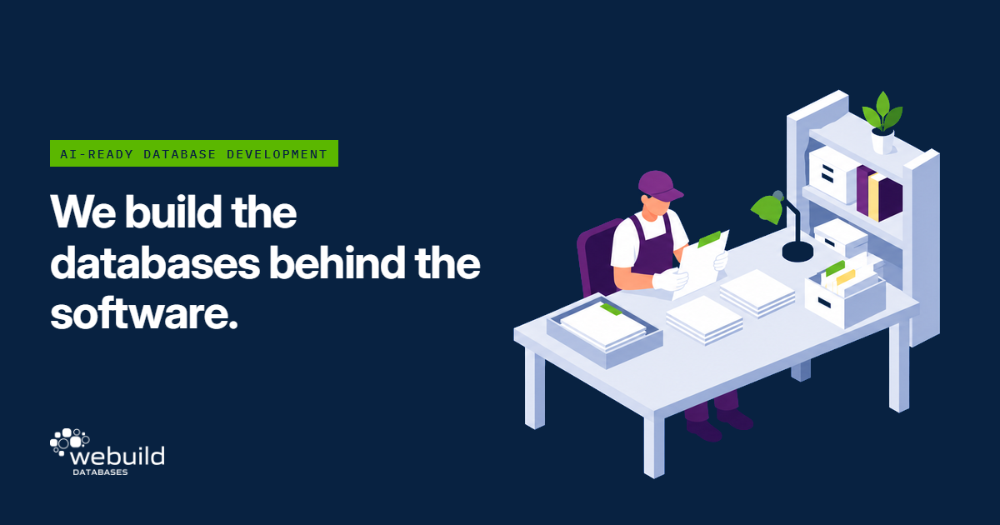

## We build the databases behind the software

Since 2006 we have designed and built the data layer for companies in freight, manufacturing, finance and professional services: custom databases, cloud migrations, reporting, and now the AI work that sits on top of clean data.

[Website](https://webuilddatabases.com) · [Blog](https://webuilddatabases.com/trends-in-data-driven-solutions/) · [AI Data Preparation](https://webuilddatabases.com/service/ai-data-preparation/) · [AI Automations & Assistants](https://webuilddatabases.com/service/ai-automation-assistants/) · [Talk to us](https://webuilddatabases.com/custom-database-contact-us/)

## What we publish here

Studies we ran on our own data problems, with the prompts, tests and results so anyone can replay them.

- [jev-job-by-job](https://github.com/WeBuildDatabases/jev-job-by-job): TypeSafe's Jev decision model tested on all 21 official cookbooks. Read the write-up: [Jev, job by job](https://webuilddatabases.com/blog/jev-job-by-job/).
- [homepilotiq-privacy](https://github.com/WeBuildDatabases/homepilotiq-privacy): the privacy policy for Home Pilot IQ.
